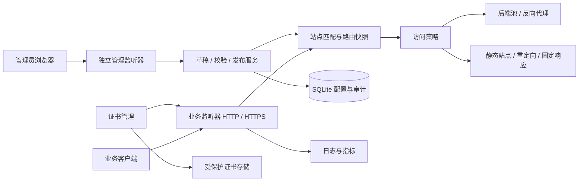

# v2way 统一网关设计方案（第一版）

> 编写时间：2026-10-30 16:06:29 +08:00
>
> 状态：设计基线已确认，用户已授权继续实现；当前完成范围见 [实施状态](implementation-status.md)。下文保留完整产品目标，不代表全部能力已实现。
>
> 项目根目录：`/home/lswl/code/v2way`。

> 存储设计修订：用户已明确不使用 SQLite。本文涉及 SQLite 与数据库事务的设计由 [JSON 文件持久化版](unified-gateway-json-design.md) 替代，其余产品定位与功能设计继续作为基线。当前已实施 JSON 存储主体，实际命令和恢复边界见 [JSON 存储说明](json-storage.md)。

> 监听设计修订：业务端口已改为在站点中配置，支持多站点共享同协议端口，不再预设全局 HTTP/HTTPS 端口；现行规则见 [站点监听说明](site-listeners.md)。

## 1. 产品定位与默认假设

v2way 是面向个人与小型团队的可视化统一网关，用一个中文控制台管理多个应用的域名、路由、后端服务、静态资源、HTTPS 和访问策略，逐步替代手写 Nginx 配置及其常见 Web 入口职责。

v2way 作为独立项目设计、开发、部署与验收。`../termical` 和 `../vxv` 仅提供前端视觉与交互风格参考，不属于本项目的接入、改造、迁移或联调范围；网关能力不依赖它们的业务协议、部署方式、账号或运行环境。

本版按“单机、多站点、单管理员、数十至数百条路由”设计。后端可以位于本机、容器网络或其他服务器。多机控制面、集群配置同步及强多租户隔离作为后续扩展，不预设分布式基础设施。

优先按独立子域名接入应用，例如 `app.example.com`、`api.example.com`。子路径部署仅用于明确支持基础路径的应用，不假设网关可以自动修正应用生成的绝对 URL、Cookie Path 或 Service Worker 作用域。

“替代 Nginx”的首要范围是 HTTP/HTTPS、反向代理、WebSocket、SSE、静态站点、负载均衡、证书及基础流量治理。第一版不承诺 Nginx 指令级兼容，也不覆盖 TCP/UDP stream、邮件代理、FastCGI、Lua/OpenResty、完整 WAF 或高性能内容缓存。

## 2. 前端风格参考

以下结论来自源码阅读，没有启动相邻项目或修改其文件。

| 项目 | 视觉与交互参考 | 在本项目中的应用 |
| --- | --- | --- |
| Termical | 深灰窗口、20px 外边距、窄侧栏、蓝色选中态、终端字体 | 主窗口层次、配色、字体与紧凑布局 |
| vxv（当前产品名 Zevo） | 左侧导航、紧凑列表、统一设置卡片、详情视图、移动端抽屉 | 导航、对象列表、设置表单、详情与响应式交互 |

主要本地依据：

- `../termical/client/src/style.css`、`../termical/client/src/App.vue`。
- `../vxv/apps/web/src/style.css`、`../vxv/apps/web/src/settings-ui.css`、`../vxv/apps/web/src/settings-components.tsx`。

网关功能、技术选型和验收标准均围绕通用网关需求制定；前端参考不引入对相邻项目代码、构建产物或部署配置的依赖。

## 3. 首版交付范围

### 3.1 可用版本必须具备

1. **站点与监听**：HTTP、HTTPS、精确域名、单层通配域名、未知域名拒绝服务、HTTP 到 HTTPS 跳转。
2. **路由**：精确路径、路径前缀、方法匹配；代理、静态目录、固定响应与重定向四种动作。
3. **后端服务**：HTTP/HTTPS 地址池、加权轮询、主动/被动健康检查、连接池和明确的失败反馈。
4. **长连接**：WebSocket 透传、SSE 流式输出、客户端取消传播、独立超时策略。
5. **静态站点**：SPA 回退、索引文件、MIME、ETag/条件请求、Range 与按路径配置缓存头。
6. **HTTPS**：上传证书、到期提醒、证书热切换；在正式公网替换前完成 ACME 自动签发与续期。
7. **访问治理**：IP 白名单/黑名单、请求体限制、请求头策略、速率与并发限制；站点可选 Basic Auth。
8. **控制台**：登录、概览、站点、路由、后端、证书、日志、配置版本及系统设置。
9. **配置运维**：草稿、校验、差异预览、发布、状态查询、回滚、备份与恢复。

### 3.2 后续扩展

DNS-01 与泛域名自动证书、OIDC/外部认证、细粒度 RBAC、Docker 服务发现、Prometheus 接入、gRPC/h2c 专项兼容、TCP/UDP 代理、多节点配置分发与高可用。

网关首版不会代替应用自身的登录、CSRF 或 Origin 校验，也不默认添加跨域许可。网关访问控制与应用权限分别生效。

## 4. 技术路线

### 4.1 建议方案

采用 **Go 数据面与管理服务 + React / TypeScript 控制台 + SQLite**。前端由 Vite 管理开发与构建，发布时通过 `go:embed` 内嵌管理端静态产物，以一个主程序部署；业务站点的静态目录单独挂载。

| 层次 | 建议选择 | 原因与约束 |
| --- | --- | --- |
| HTTP 数据面 | Go `net/http`、`httputil.ReverseProxy` | 基于标准库实现受控功能集合；协议解析不自行重写 |
| 路由与策略 | 编译后的不可变配置快照 | 请求路径不查询数据库，不随 UI 编辑即时变化 |
| HTTPS 自动化 | CertMagic | 复用证书管理库；不自行编写 ACME 协议，先完成依赖与许可核查 |
| 管理 API | Go HTTP 路由 + JSON | 与数据面共享配置模型，使用独立监听器 |
| 管理前端 | React、TypeScript、Vite、CSS 变量 | 支持独立组件开发与类型检查；以 CSS 变量统一视觉，无需引入完整重型组件库 |
| 配置与账户 | SQLite，迁移文件版本化 | 单实例事务存储；驱动在实施阶段按目标平台、CGO 和许可确定 |
| 日志 | 结构化 JSON 文件或标准输出 | 与配置数据库分离，避免高频写入挤占发布事务 |
| 指标 | 内存聚合与有限窗口 | 第一版不引入外部时序数据库 |

Go 的代理提供流式刷新及转发头处理接口，具体行为按官方文档核对，仍须验证中间件不会破坏这些能力。[Go 代理文档](https://pkg.go.dev/net/http/httputil#ReverseProxy)

CertMagic 提供自动证书生命周期管理；能否签发还取决于域名、公网验证入口、CA 限额和存储条件，不把“保存域名”显示为“证书已就绪”。[CertMagic 官方仓库](https://github.com/caddyserver/certmagic)

### 4.2 备选方案与取舍

| 路线 | 优势 | 代价 | 本版结论 |
| --- | --- | --- | --- |
| Go 原生代理 + CertMagic | 单程序、模型统一、行为可精确定义 | 网关策略、连接管理、性能验证均需自己维护 | 推荐，限制第一版范围并设置替换门槛 |
| Go 控制面 + Caddy 数据面 | 复用成熟代理、自动 HTTPS 与动态配置能力 | 增加进程/配置映射及运行状态一致性工作 | 若协议/性能验证未达标，优先切换此路线 |
| 生成 Nginx 配置的管理面板 | 能复用原有指令与经验 | 仍依赖 Nginx，配置加载与错误映射复杂 | 不作为本项目目标 |

Caddy 具有管理 API，可作为成熟数据面的备选，不意味着本项目已决定依赖或部署 Caddy。[Caddy 官方 API 文档](https://caddyserver.com/docs/api)

实施前锁定仍获安全维护的 Go、Node.js 与依赖版本，不在方案阶段假定相邻项目版本必须原样沿用。

## 5. 系统结构与网络边界



- 拟定业务监听：`0.0.0.0:8080` 与 `0.0.0.0:8443`，未配置证书时不开启 HTTPS；管理监听：`127.0.0.1:4033`。均可在启动配置中调整。
- 普通用户进程使用高位端口；正式接入 80/443 所需的宿主端口映射或系统配置由用户安排，不要求程序自行提权。
- 管理监听与业务监听隔离，业务端口不自动暴露管理 API、指标或调试端点。远程管理须显式启用 HTTPS 管理入口或通过安全隧道访问。
- 启动配置保存数据目录、监听地址与密钥文件位置，修改后重启生效；站点、路由、策略和证书可热更新。首版不提供任意动态新增监听端口。
- 控制面暂时不可用时保留当前数据面快照；同一进程崩溃仍影响全部业务，首版不宣称具备进程或主机高可用。

## 6. 领域模型与路由语义

### 6.1 核心对象

| 对象 | 关键字段 | 关系与约束 |
| --- | --- | --- |
| 站点 | 名称、域名、启用状态、HTTPS 模式、证书引用 | 归属固定业务监听；域名绑定冲突必须校验 |
| 路由 | 站点、路径类型、路径、方法、动作、策略引用 | 每条路由只有一种终结动作 |
| 后端池 | 名称、目标地址、权重、健康检查、TLS 设置 | 多条代理路由可复用；被引用时不可直接删除 |
| 静态目录 | 名称、批准的根目录、索引、SPA 与缓存策略 | 只能引用管理员配置的站点根目录 |
| 策略 | 请求体限制、速率、IP、请求头、超时、可选认证 | 全局默认 → 站点 → 路由；发布时展示最终有效值 |
| 证书 | 域名、来源、指纹、到期时间、状态、秘密引用 | 元数据入库，私钥不进入普通 API 或配置导出 |
| 配置版本 | 版本号、父版本、摘要、配置快照、操作者、时间 | 发布版本不可修改；回滚产生新的发布记录 |
| 发布任务 | 请求标识、目标版本、状态、错误、激活时间 | 支持超时后查询，避免客户端盲目重复发布 |
| 管理账户与会话 | 账户、密码摘要、会话摘要、有效期 | 首版单管理员；无默认密码 |
| 审计事件 | 操作者、动作、对象、结果、配置版本、时间 | 与业务访问日志分开，不存储秘密正文 |

### 6.2 确定性的匹配规则

1. 先按入口端口与规范化 Host 选择站点；域名转小写并校验 IDNA，正确拆分端口和 IPv6。HTTPS 同时检查 SNI 与允许的 Host，未知 SNI 不签发证书。
2. 精确域名优先于单层通配域名；通配域名 `*.example.com` 仅匹配一层子域名。相同优先级的重叠绑定拒绝发布。
3. 站点内先匹配精确路径，再匹配最长前缀；`/api` 前缀匹配 `/api` 与 `/api/...`，不匹配 `/apix`。最后才进入显式 `/` 兜底。
4. 方法条件进一步筛选；同等路径下方法重叠的多条规则拒绝发布。不采用隐含创建顺序决定优先级，首版不支持正则路由。
5. 默认保留路径、查询参数和原始 Host；“去除路径前缀”“设置后端 Host”必须显式配置。后端地址首版不携带业务基础路径，避免双重拼接。
6. 不主动更改百分号编码、重复查询参数与查询顺序；非法转义或存在解释歧义的编码路径按确定规则拒绝，覆盖签名 URL 与路径混淆回归测试。
7. 无匹配站点/路由返回 404；无健康后端返回 503；后端连接失败返回 502；等待响应头超时返回 504；超限返回 413 或 429。

发布前提供“路由测试”：输入协议、域名、方法和路径，展示命中站点、路由、动作、改写结果与有效策略。该工具默认只做本地规则推演，不访问目标服务器。

## 7. 代理、长连接与静态资源

### 7.1 HTTP 与后端健康

- 连接池按后端传输配置复用；配置淘汰后等待旧请求结束，再回收空闲连接，不在每次请求创建 Transport。
- 健康探测可配置路径、间隔、超时、成功状态码和连续成功/失败阈值；默认不自动跟随重定向，不将探测请求计入业务日志。
- 后端全部异常时停止分配；恢复后逐步重新纳入。活动连接与健康状态属于运行态，不覆盖已发布配置。
- 默认不自动重试；后续即便开放重试，也只允许明确可安全重放、尚未输出响应且请求体可重放的请求。POST、上传和流式请求不隐式重试。
- 后端 HTTPS 默认验证 CA 与名称；支持指定受信 CA 和服务器名，不提供全局跳过证书校验的默认配置。
- 默认清理外来 `Forwarded`、`X-Forwarded-*` 与 `X-Real-IP` 后重建；只有配置为受信的前置代理 CIDR 才能贡献原始客户端链，防止伪造来源绕过限流/IP 策略。
- 请求/响应头策略禁止随意操作 hop-by-hop 与协议保留字段；日志中间件保留刷新、升级及底层响应能力。

### 7.2 拟定初始限制

| 配置 | 拟定默认值 | 说明 |
| --- | --- | --- |
| 请求头读取超时 / 最大头大小 | 10 秒 / 64 KiB | 防止慢速请求头与过大头部 |
| 后端连接 / TLS 握手超时 | 各 5 秒 | 与响应正文传输时间分离 |
| 等待后端响应头 | 30 秒 | 长轮询路由可单独提高 |
| 普通请求体上限 | 20 MiB | 按流读取并限制，不先把正文完整载入内存 |
| 普通 HTTP 总处理预算 | 60 秒 | 按路由配置；上传和长响应须显式调整 |
| WebSocket / SSE 总时长 | 不设置固定总时长 | 独立连接配额、取消与空闲策略；不能继承普通预算 |
| 长连接空闲上限 | 604800 秒 | 通用长时会话的初始建议值；可按站点调整 |
| 进程停机排空预算 | 30 秒 | 到期主动结束剩余连接，客户端按应用协议重连 |

这些数值是待验证的默认设计，不是已测容量保证。流式连接须明确空闲的判定方式，并覆盖静默终端；不得因为没有业务输出就误判连接失败。

### 7.3 WebSocket 与 SSE

- WebSocket 保留握手所需的 Origin、子协议等字段，不自行注入应用凭据。验证双向大消息、慢端、静默连接及一侧断开后的资源回收。
- SSE 不使用整包缓冲、内容缓存或会延迟输出的压缩链；收到事件即向客户端刷新。流式正文与等待首字/响应头分别管理。
- 客户端断开需取消对应后端请求；通过单站点/全局活动流配额防止无限连接，限流不按每条 SSE 消息计费。
- 配置热切换时新请求使用新快照；已建立的 WebSocket 与 SSE 继续使用旧快照。停机与删除规则不会迁移现有连接，紧急断开作为单独操作并记录审计。
- 显式维护升级连接登记与排空逻辑；Go 的 `Server.Shutdown` 不会自动等待或关闭 WebSocket 等已劫持连接。[Go 停机文档](https://pkg.go.dev/net/http#Server.Shutdown)

### 7.4 静态站点与 PWA

- 只读提供已批准根目录内的文件，禁止目录列表、路径穿越、编码绕过与符号链接越界；静态根目录不能指向数据/密钥目录。
- SPA 回退仅作用于明确启用的前端页面路由；缺失 JS/CSS/图标返回 404，API 和 WebSocket 绝不回退到 HTML。
- `/index.html`、`/sw.js`、`/manifest.webmanifest` 默认 `no-cache`；内容哈希资源目录可设一年 `immutable`。支持按站点配置 `Service-Worker-Allowed`，与实际需要的作用域一致。
- 支持预压缩资源时正确处理 Content-Encoding、Vary 和 Range；不在第一阶段自行开发动态内容缓存系统。

## 8. HTTPS、账户与数据保护

### 8.1 证书生命周期

- 上传证书时检查 PEM 格式、证书与私钥匹配、有效期、链及域名覆盖；已引用证书删除前必须替换或解绑。
- 新证书加载成功后原子切换；加载失败继续保留旧证书。到期前 30/14/7 天在控制台提示，续期失败显示原因与重试时间。
- 首版自动签发采用 HTTP-01；开启前检查域名解析、公共 80 端口可达和挑战路径归属。挑战处理优先于普通重定向/站点认证；首次验证使用 CA 测试环境。
- DNS-01 与泛域名自动签发后续实现；首版泛域名 HTTPS 可使用上传的有效证书。未配置域名不做按需签发，防止滥用与 CA 限额耗尽。
- 首次自动证书异步准备完成前，站点显示“待签发”，不发布会导致 HTTPS 无法握手的强制跳转配置。续期通常不改变路由版本，但记录独立证书事件。

### 8.2 管理访问

- 首次管理员通过本地 CLI 与交互输入初始化，不提供公开“抢注管理员”页面；密码使用 Argon2id 等成熟算法保存摘要。
- 使用服务端会话与 HttpOnly、SameSite Cookie；HTTPS 管理入口启用 Secure。回环 HTTP 仅用于本机初始化，远程管理必须采用安全连接。
- 管理写操作验证 CSRF 与允许的 Origin；登录限速、空闲过期、绝对过期、退出撤销。管理认证不复用业务站点 Basic Auth。
- 后端探测、静态目录和证书操作均只允许已登录管理员。允许显式配置内网后端；拒绝云元数据、链路本地及组播等特殊目标，解析结果变化时复核并约束实际拨号，防止探测接口成为任意 SSRF 通道。

### 8.3 持久化与恢复

- SQLite 保存配置、账户、审计及版本，启用外键与迁移检查。业务访问日志单独写入，并设置轮转和保留配额。
- 私钥、ACME 账户及认证秘密保存在仅进程用户可访问的目录；数据库中的秘密字段使用独立主密钥加密。主密钥不与普通配置一起导出。
- 普通 JSON/YAML 导出仅包含配置与秘密引用；完整备份需显式选择加密备份，覆盖一致性数据库快照、证书、秘密和密钥恢复材料。
- 启动加载最近一次已激活版本；无有效配置时业务入口不提供任意兜底代理，仅开启本地恢复入口。不能把损坏数据库静默重建为空库。

## 9. 配置发布与回滚

管理数据库与运行快照无法通过单个 SQLite 事务完成跨内存原子提交，采用可恢复发布状态机，而不是声称“两者天然原子”。

1. **编辑草稿**：对象编辑只修改草稿，以基础版本和修订号进行乐观并发控制；冲突返回 409，不覆盖他人的更新。
2. **完整校验**：检查结构、引用、路由重叠、目录权限、监听约束、证书和资源预算。后端暂时离线展示警告，允许带警告发布；语义错误阻止发布。
3. **差异预览**：列出新增/修改/删除的对象、受影响域名、可能中断的策略及需重启的启动配置。
4. **持久化准备**：生成不可变配置版本及 `prepared` 发布任务；先完成可能失败的资源准备与同步落盘，再进入激活。
5. **激活快照**：单发布锁下原子替换运行快照，新请求读取新版本；任务进入 `activated`，持久化活动版本指针后标记 `succeeded`。
6. **查询结果**：响应包含任务 ID、配置版本、运行版本与错误；客户端超时后按原任务 ID 查询，不重复创建版本。API 支持幂等请求标识。
7. **失败恢复**：激活前失败保持旧快照；激活后持久化失败进入明确的待恢复状态并暂停后续发布。重启根据已持久化阶段恢复到最后完成的版本，展示中断记录。
8. **回滚**：选择历史版本，重新校验当前可用的目录、证书和秘密引用，发布为新版本；不能假定历史依赖仍存在。

证书更新与路由发布使用独立资源引用管理；旧快照仍持有的后端池和证书对象延迟释放。账户修改、审计写入与运行态计数不进入业务配置回滚。

## 10. 控制台信息架构与视觉方案

### 10.1 页面布局

桌面采用 Termical 的内嵌窗口感与 Zevo 的左导航工作区：外边距 20px，主窗口圆角 10px、1px 深灰边框；左栏默认 220px，允许在 180–300px 调整；顶部 48px 显示页面标题与发布状态，主体独立滚动。

```text
┌─────────────────────────────────────────────────────────────┐
│ v2way            │ 站点管理               当前版本 12        │
│                  │ 草稿有 2 项变更         [预览并发布]       │
│ 概览             ├───────────────────────────────────────────┤
│ 站点             │ 搜索名称或域名     状态筛选     [新建站点] │
│ 路由             │                                           │
│ 后端服务         │ 应用站点          已启用 · HTTPS 正常     │
│ 证书             │ app.example.com            2 条路由       │
│ 访问日志         │ [路由配置] [访问策略] [查看日志]           │
│ 配置版本         │                                           │
│ 系统设置         │ 接口服务          后端异常                │
│                  │ api.example.com            3 条路由       │
│ 数据面：运行中   │ [路由配置] [访问策略] [查看日志]           │
│ 管理员 · 退出    │                                           │
└─────────────────────────────────────────────────────────────┘
```

此处是信息结构示意，不是已开发页面；示例域名与版本数字均为虚构。

### 10.2 色彩与组件规格

| 用途 | 设计值 | 参考与用法 |
| --- | --- | --- |
| 页面/工作区底色 | `#181818` | 两个参考项目共同底色 |
| 侧栏/卡片底色 | `#202020` | Zevo 侧栏及设置卡片 |
| 浮层/编辑区 | `#252526` / `#292929` | 形成有限层级，减少装饰 |
| 分隔线/输入边框 | `#333333` / `#454545` | 1px 边框，保持低对比 |
| 主文字/次文字 | `#d4d4d4` / `#969696` | 主体 13–14px；辅助信息 12px |
| 主操作/焦点 | `#007acc` | 蓝色主按钮、焦点轮廓、选中标记 |
| 导航悬停/选中 | `#2a2d2e` / `#37373d` | 左侧 2px 蓝色选中线 |
| 成功/警告/错误 | `#89c695` / `#dbb861` / `#ef9892` | 颜色之外必须有中文状态文字 |

- 采用本地托管 JetBrains Mono 表现域名、路径、数值与代码，中文使用系统中文字体回退；不直接复制邻项目字体二进制，先确认许可。
- 以 4/8/12/16/24px 间距组织内容；控件高 34px，按钮圆角 4px，卡片圆角 6px。普通列表紧凑，避免大面积渐变和装饰图表。
- 公共组件包含：页面标题、筛选栏、状态标签、对象卡片、表单分组、保存栏、差异视图、确认弹窗、详情抽屉、空态与分页。
- 复杂对象编辑使用有独立 URL 的详情页；日志详情用右侧抽屉；删除、退出未保存编辑与发布确认使用弹窗。避免多层弹窗堆叠。
- 表单底部显示“保存草稿”；全局显示“有未发布变更”与“预览并发布”。不把保存草稿误提示为线上生效。
- 支持键盘导航、可见焦点、表单错误关联、弹窗焦点回归与减少动画偏好；长域名可截断但可复制完整值。
- 小于 720px 使用抽屉导航、单列表单、整页对象详情；图标动作始终可见，触摸目标至少 40px；宽日志表可横向滚动。

### 10.3 关键页面

| 页面 | 核心内容 | 核心操作 |
| --- | --- | --- |
| 概览 | 站点/后端健康、请求与错误率、活动连接、证书告警、当前发布版本 | 定位异常，进入对应对象 |
| 站点 | 域名、HTTPS、后端概况、配置/运行双状态 | 新建、停用、站点详情、访问日志 |
| 路由 | 域名、方法、路径、动作、后端、有效策略 | 新建、编辑、规则推演、冲突定位 |
| 后端服务 | 地址池、健康、延迟、最近失败原因 | 修改权重、探测、临时摘除 |
| 证书 | 域名、来源、指纹、有效期、签发/续期状态 | 上传、申请、续期、替换 |
| 访问日志 | 时间、站点、路由、状态、耗时、字节数、请求 ID | 过滤、暂停实时、详情、受控导出 |
| 配置版本 | 草稿、差异、发布任务、版本与操作者 | 校验、发布、查询、回滚 |
| 系统设置 | 账户、启动配置说明、日志配额、备份恢复 | 修改密码、导出配置、加密备份 |

不使用大量装饰性仪表盘。概览仅展示已有真实指标；首次无站点时引导“创建站点”，无流量时显示“暂无请求”，不填充虚构成功率。

## 11. 日志、指标与诊断

- 访问日志记录时间、请求 ID、站点/路由 ID、使用的配置版本、方法、规范化路径、状态、耗时、收发字节数和后端；长连接区分握手与关闭记录。
- 默认不记录请求体、响应体、Cookie、Authorization、私钥或完整查询字符串。查询参数可能携带令牌等秘密，不得落入日志或错误详情。
- 指标按站点与路由聚合请求量、错误率、时延、活动连接与后端健康，禁止将任意 URL/IP 作为无限基数标签。长连接单独统计持续时间与流量。
- 拟定业务日志按日或 100 MiB 轮转，默认保留 7 天、总配额 1 GiB；审计默认保留 90 天并设独立配额。磁盘接近上限时告警，满盘不得无限重试刷日志。
- 实时日志使用受认证 SSE、有限队列与背压；页面暂停不保留无限消息。支持按请求 ID 追踪，错误提示给出安全诊断与定位入口。
- 配置审计失败阻止新的管理变更；业务日志写入失败采用有界降级并告警，不默认中断全部转发。两类失败不能混为一谈。

## 12. 管理接口与目录规划

管理 API 使用独立监听器上的 `/api/admin/v1`；业务应用中的同名路径不会进入管理处理器。

| 接口组 | 拟定职责 |
| --- | --- |
| `/session` | 登录、状态、退出 |
| `/sites`、`/routes`、`/upstreams`、`/policies` | 草稿对象管理与修订冲突处理 |
| `/certificates` | 元数据、上传、签发任务、续期状态；不回传私钥 |
| `/draft/validate`、`/draft/diff` | 完整校验与差异 |
| `/route-tests` | 规则推演，不触发真实请求 |
| `/releases`、`/releases/{id}` | 幂等发布、任务结果查询 |
| `/versions`、`/versions/{id}/rollback` | 已发布版本与回滚发布 |
| `/logs`、`/events`、`/overview` | 有界查询、实时事件和运行概览 |
| `/backup`、`/restore` | 加密备份与恢复预检；恢复需维护窗口 |

拟定目录：

```text
v2way/
  AGENTS.md / CLAUDE.md
  cmd/v2way/                 主程序、校验与账户初始化入口
  internal/admin/            管理 API、会话与 CSRF
  internal/config/           模型、校验、编译、发布与恢复
  internal/gateway/          匹配、代理、静态服务与连接管理
  internal/upstream/         连接池、健康检查与负载均衡
  internal/certificate/      上传、ACME、证书热更新
  internal/policy/           访问限制、请求头与超时
  internal/store/            SQLite、迁移与秘密引用
  internal/telemetry/        日志、指标、审计
  web/                       React 控制台与设计令牌
  deploy/                    普通用户部署模板与说明
  tests/                     协议集成、恢复与性能场景
  docs/                      方案、运维与按月 changelog
```

运行数据使用独立数据目录，不放在前端静态根目录；数据库、日志、证书、密钥与备份子目录分别管理权限。以上目录仅为规划，本轮不创建应用骨架。

## 13. 独立部署与接入方式

### 13.1 独立交付

- 独立提供主程序、内嵌中文控制台、启动配置示例、账户初始化入口及运维文档，具备自己的版本和发布流程。
- 数据目录、配置数据库、证书和日志由 v2way 自主管理，不复用其他项目的数据与凭据。
- 普通用户可通过高位端口部署；容器化模板作为可选交付方式，不要求宿主存在 Nginx 或其他参考项目。
- 通过本项目自建的模拟 HTTP/HTTPS 后端、WebSocket/SSE 服务和静态测试站点完成首次部署验证。

### 13.2 通用接入流程

1. 初始化管理员、数据目录和监听地址。
2. 创建后端池或批准的静态根目录，设置健康检查与必要策略。
3. 创建站点、绑定域名、配置路由并执行规则推演。
4. 上传证书或申请自动证书，校验后发布配置。
5. 通过测试域名或高位端口验证响应、日志和连接行为，再由部署者安排正式入口。

后端地址由部署者显式配置；独立容器中的 `127.0.0.1` 指向网关自身，跨容器或宿主访问需使用实际可达地址。静态目录通过已批准的宿主路径或只读卷提供，网关不自动读取其他应用的内部文件。

### 13.3 产品交付与运行恢复

- 发布包需在独立测试环境完成安装、初始化、启动、建站和备份恢复验证，覆盖数据目录权限与端口冲突提示。
- 升级前备份配置、数据库、证书及密钥恢复材料；数据库迁移需有明确的版本兼容说明，不能仅替换旧程序就假定可回退。
- 运行故障通过配置版本回滚或备份恢复处理；程序回退须核对数据库兼容性。
- 实际使用方替换既有入口时，其 DNS、端口与应用调整属于具体部署工作，另行确定范围；本方案不安排任何相邻项目的迁移任务。

## 14. 实施阶段与验收

用户已授权按以下阶段继续实现。已完成项及开发版本边界见 [实施状态](implementation-status.md)；构建发布产物、启动服务和调整现有部署仍遵循各自的授权要求。

| 阶段 | 交付内容 | 完成标准 |
| --- | --- | --- |
| P0：协议验证 | 最小代理、不可变快照、WebSocket/SSE、静态与手动 TLS 技术验证 | 使用自建测试服务验证通用网关关键场景；失败则评估 Caddy 数据面 |
| P1：管理闭环 | 账户、对象模型、中文控制台、草稿/发布/回滚、日志 | 可在控制台完成建站到安全发布；冲突和失败可解释 |
| P2：公网可用 | ACME、健康检查、限流、备份恢复、崩溃恢复、安全验证 | 通过故障注入和恢复演练，具备替换公网入口的最低条件 |
| P3：独立交付验收 | 通用协议与缓存回归、同机性能对照、部署包、运维说明 | 在独立环境完成部署、建站、升级及恢复演练；不依赖参考项目 |

关键测试：

- **匹配与隔离**：域名/端口/SNI、路径边界、编码路径、重复查询、重叠方法、未知 Host、管理 API 不外泄。
- **协议**：上传超限、慢客户端、后端拒绝/超时、取消、背压、WebSocket 子协议/重连、SSE 首事件及时输出与长轮询。
- **静态与缓存**：SPA 深层刷新、资源缺失 404、目录穿越/符号链接、Range、PWA 更新后获得新 HTML 和 Service Worker。
- **配置恢复**：并发编辑、重复发布、发布回执丢失、各阶段进程异常、满盘、坏证书、历史秘密丢失、重启后的有效版本。
- **安全**：转发头伪造、登录限速、CSRF、会话撤销、探测 DNS 重绑定、日志脱敏、备份恢复后私钥可用且不泄露。
- **通用兼容性**：通过自建测试服务覆盖认证头/Cookie 透传、WebSocket 双向数据与重连、SSE 连续事件、文件上传下载、SPA 与 PWA 缓存；不使用参考项目账号或运行环境。

性能门槛采用同机、同后端、同日志级别、同 TLS 和同负载进行对照：拟定 100 条路由、500 个并发普通连接及 100 个活动长连接，分别测量小响应、大文件与流式传输。以无协议错误、24 小时运行无持续内存增长为底线；P95/P99 延迟、吞吐和 CPU/RSS 的可接受差距在 P0 基准后确定，未测量前不声称优于 Nginx。

## 15. 本版决策与后续扩展方向

按当前需求可直接采用的默认方向：单机部署、独立域名、中文深色控制台、Go 原生代理、SQLite、React、配置显式发布与可恢复回滚。

当前按上述默认方向推进，后续扩展时再明确以下事项：

1. 通用网关首版范围是否需要包含 TCP/UDP、gRPC、复杂正则 rewrite 等当前列为后续扩展的能力。
2. 产品优先支持的运行方式、目标平台和证书来源，以及首次交付所需的安装与运维体验。
3. 是否接受自行维护有限范围的 Go 数据面，或更偏向以 Caddy 提供成熟代理能力、v2way 专注管理体验。

上述扩展事项不阻塞已授权的首版实现；不据此扩大到相邻项目改造或现有服务调整。
